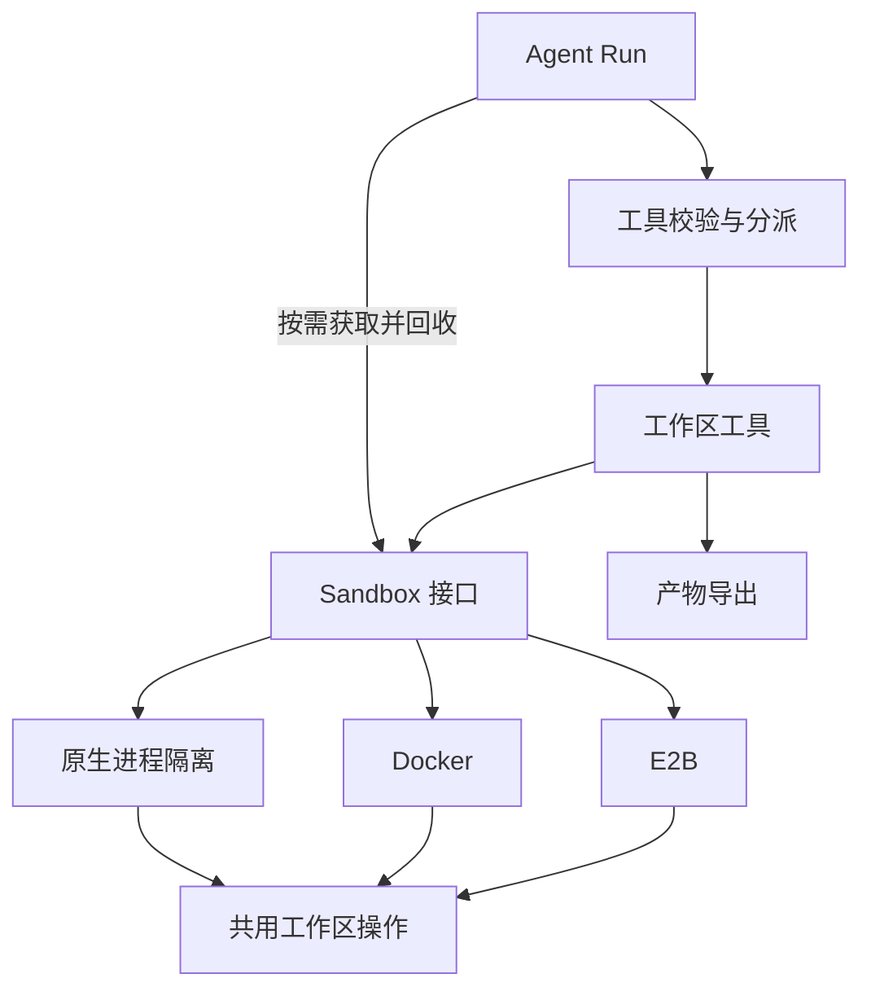

# 工作区工具与沙箱

模型调用的是一套工作区工具。`ToolRegistry` 检查工具授权和参数，处理函数取得当前 Run 的 `Sandbox`。本地后端和服务端的 Docker、E2B 共用文件操作与交付协议。文件、命令和浏览器因此可以共享同一个工作区。



## 瞬时故障重试

| 调用 | 自动重试行为 |
|---|---|
| Chat Completions 和 Responses | 连接错误、请求超时及 SDK 认定可重试的 HTTP 错误最多再试两次，使用 SDK 退避。一次模型调用连同重试最多 5 分钟，HTTP 读写的空闲超时为 3 分钟。 |
| 生图 | 服务明确限流并返回 HTTP 429 时最多再试两次。提供 `Retry-After` 时遵循该等待时间。收到回执前断线或超时可能已经出图，当前调用返回错误。 |
| Docker | 本机 daemon 探测、容器启动和回收遇到瞬时传输错误时最多再试两次。启动重试前先清理同名的部分启动容器。 |
| E2B | 创建请求明确被拒绝或连接尚未建立时可重试。对单个租约可重试传输请求文件、取回响应和回收租约。 |
| 工作区读取 | `ls`、`read_file`、`search_files` 和下载会重试瞬时传输错误。写入、脚本和浏览器操作在执行结果未知时返回错误，由调用方检查状态。 |

## 工具清单

| 工具 | 接口与行为 |
|---|---|
| `ls` | 列出文件和子目录。默认查看工作区根目录一层，可递归、按类型过滤和分页。 |
| `read_file` | 按行读取工作区里的 UTF-8 文本，`next_line` 可用于继续阅读。 |
| `search_files` | 按 glob 找文件，可选字面文本查询并返回行号。文本搜索会跳过常见依赖目录和二进制文件。 |
| `write_file` | 原子写入整份 UTF-8 文本，按需创建父目录。`overwrite` 可以控制覆盖。 |
| `copy_file` | 复制工作区里的单个文件，支持二进制，默认保留已有目标。 |
| `run_command` | 用 `argv`、`cwd` 和 `timeout_seconds` 运行 Python、Node.js 或后端提供的系统程序。返回退出码、stdout、stderr、超时与截断状态。 |
| `install_dependencies` | 通过 PyPI 或 npm 安装当前任务要用的额外库，下一次 `run_command` 即可导入。 |
| `playwright` | 预览工作区 HTML，支持点击、填值、按键、文本断言和 PNG 截图。服务端后端还支持临时测试服务器和允许列表内的公网 HTTPS 页面。 |
| `generate_image` | 用配置的 OpenRouter 生图模型生成封面、网站主图或说明插画等素材，返回工作区路径、格式、字节数和模型 ID。 |
| `submit_results` | 批量导出指定文件，返回 `ArtifactRef` 并记录产物和 UI 附件。随后 Agent 可以继续总结结果。 |

`run_command` 统一了命令执行入口。需要 shell 时，可以在 `argv` 中显式选择当前系统的 Shell，例如 macOS 和 Linux 的 `bash`、Windows 的 `cmd`。工作目录和超时由沙箱校验。[OpenAI Shell 工具指南](https://developers.openai.com/api/docs/guides/tools-shell)

常规文件操作使用工作区相对路径。`playwright` 适合验证 Agent 生成的本地网页和启动的测试服务器，截图写回工作区。用 `submit_results` 选出交付文件，批次在全部读取成功后才出现在产物目录中。

`ls` 的 `directory` 默认为 `.`。用 `kind=file` 或 `kind=directory` 筛选类型，用 `recursive=true` 查看子目录。结果按路径排序。下一页沿用原参数，将 `next_cursor` 传入 `cursor`。如果 `truncated=true` 且 `next_cursor` 为空，可以缩小目录范围继续查找。

## 办公与数据处理依赖

源码安装预先准备 Python 3.12、Node.js 24、npm 和 Playwright Chromium。原生安装包也可用 `agent-cook setup-runtime` 提前准备。本地与新服务端镜像使用同一份 Python 包清单。

| 用途 | 预装库 |
|---|---|
| Excel | openpyxl、XlsxWriter、xlrd（读取旧版 XLS） |
| Word 和 PPT | python-docx、python-pptx |
| PDF 和图片 | pypdf、pypdfium2、Pillow |
| 数据与绘图 | pandas、NumPy、SciPy、PyArrow、Matplotlib |
| 文本与配置 | charset-normalizer、PyYAML |

已安装 LibreOffice 时，本地工作区可用 `soffice` 将 PPTX 转成 PDF，再用 pypdfium2 生成逐页图片。源码安装用 `./install --with-office` 或 `.\install.cmd --with-office` 加装。服务端镜像自带无界面的 Impress 和中日韩字体。 [依赖清单](../src/agent_cook/data/native/workspace-requirements.txt) · [LibreOffice](https://www.libreoffice.org/download/)

`install_dependencies` 接受包名和可选的精确版本。安装结果在当前任务中可复用，后端回收任务工作区时一并清除。本地由专用安装器访问公共包仓库，普通任务命令继续离线。Docker 和同源 E2B 模板需要更新镜像并启用 `--sandbox-network`，工具才可用。

```json
{"ecosystem": "python", "packages": ["humanize==4.13.0"]}
```

```json
{"ecosystem": "node", "packages": ["kleur@4.1.5"]}
```

Python 从 PyPI 安装 wheel，后续使用普通的 `python` 命令导入。Node.js 可在工作区内使用 `require` 或 `import`。npm 安装时禁用生命周期脚本。工具接收 Python 和 Node.js 的公共注册表包名。

## 网页检索和浏览器补查

在 `agent-cook.json` 填写 `api_keys.exa`，或设置 `EXA_API_KEY`，CLI 和 HTTP 服务会自动注册 `web_search` 和 `web_fetch`。工具按需通过 Streamable HTTP 连接 Exa 的官方 MCP，并通过 `x-api-key` 传递密钥。`web_search` 使用 Lite，默认返回 5 条结果，`web_fetch` 读取指定 URL 的正文。[Exa MCP](https://exa.ai/docs/get-started/exa-mcp)

任务可用 `web.enabled: false` 关闭网页检索。缺少 Exa Key 时，`web.enabled: true` 会使用原有的 OpenRouter 托管搜索和抓取。运行记录的 `model.finished` 会记录 OpenRouter 返回的网页工具用量和来源。[OpenRouter 托管工具](https://openrouter.ai/docs/guides/features/server-tools)

```json
{
  "task": "Find the OpenRouter web fetch guide, verify its supported engines, and submit a short note with the source URL.",
  "web": {
    "enabled": true,
    "browser_origins": ["https://openrouter.ai"]
  }
}
```

`web.browser_origins` 可以独立配置，填写允许访问的 HTTPS 来源。Playwright 继续用 `url`、`actions` 和可选的 `screenshot` 查询公网网页。首次公网调用会启动独立的 Docker 或 E2B 浏览器沙箱。代理核对连接来源和目标 IP，浏览器拦截常规页面请求，只放行 GET 和 HEAD。截图写回任务工作区，之后可以通过 `submit_results` 提交。浏览器访问的页面记录在 `browser.page_read`。

只使用搜索和抓取时，直接用 `--request` 运行即可。配置了公网浏览器来源时，启动 `serve --sandbox docker` 或 `serve --sandbox e2b`，并构建含新版 worker 的镜像。任务 Shell 的出网通过 `--sandbox-network` 单独配置。页面依赖的 CDN 等跨域资源也需要列出对应的 HTTPS 来源。

## 按需读取 Skill

启用工作区时，Agent Cook 默认挂载 6 个内置 Skill。用 `--skills-dir` 可加入本机的 Skill 目录，显式提供的同名 Skill 优先于内置版。每项以带 YAML frontmatter 的 `SKILL.md` 为入口，`name` 与目录名一致。

用 `--skill` 或任务 JSON 中的 `skills` 缩小本次挂载名单。已启用 Plugin 引用的 Skill 一并纳入。 [Plugin 和任务扩展](plugins.md)

```bash
uv run --project . agent-cook --skills-dir /path/to/skills \
  '找到适合这个任务的 Skill，并说明它的步骤。'
```

初始模型上下文只包含每项 Skill 的 `name`、`description` 和 `entry`。工作区首次打开时，将已配置 Skill 的包文件按原目录结构复制到工作区。例如 `example/SKILL.md` 对应任务工作区中的实际文件。

模型可以用 `read_file` 读取 `example/SKILL.md`，用 `ls` 查看 `example/references`，也可以在 `run_command` 里用解释器运行 `example/scripts` 里的脚本。Skill 包仅传输普通文件，与用户输入共用传输上限。同名的工作区输入会报错，运行期间的修改保存在当前任务的副本里。

## 生图

使用沙箱时，可用 `--image-model` 或任务 JSON 的 `image_model` 选择生图模型并启用 `generate_image`。也可通过 `OPENROUTER_IMAGE_MODEL` 或模型列表中的 `image.default` 配置默认生图模型。选择支持 OpenRouter Image API 的模型。对话和生图复用 `OPENROUTER_API_KEY`，由主进程分别调用对应接口。[模型配置](install.md#模型配置) · [OpenRouter Image API](https://openrouter.ai/blog/tutorials/image-generation/)

做 PPT 或网站时，Agent 可以在需要新配图的位置调用生图工具，例如活动页主视觉、宣讲封面或概念插画。优先复用用户给的素材，按实际布局挑选比例。保留可编辑文字和由原始数据生成的图表。PPT 将图片嵌入文件，网站将图片作为本地资源随页面交付。

| 工具参数 | 用法 |
|---|---|
| `prompt` | 必填。描述用途、画面、风格和构图，注明给标题或正文留白的位置。 |
| `aspect_ratio` | 可选。指定宽高比，例如 `16:9`、`9:16` 或 `1:1`。 |
| `resolution` | 可选。指定模型支持的分辨率档位，例如 `1K` 或 `2K`。 |
| `output_dir` | 可选。工作区相对目录，默认为 `generated-images`。文件名由工具生成。 |

比例和分辨率沿用所选模型的默认值，除非调用时显式指定。工具用实际图片格式确定扩展名，支持 PNG、JPEG 和 WebP，单张图片最多 16 MiB。可以用返回的 `path` 将图片放进网页，也可以用 `submit_results` 导出。

```bash
uv run --project . agent-cook \
  --model 'provider/chat-model' \
  --image-model bytedance-seed/seedream-4.5 \
  '生成一张 16:9 的深蓝色城市夜景，用 submit_results 交付图片。'
```

## 本地执行与文件边界

本地 CLI 默认启用原生工作区。用户选择的文件和挂载的 Skill 复制到每次任务的临时目录，Python、Node.js 和 Chromium 子进程只能写入本次目录及隔离的临时空间。子进程使用独立环境，不继承模型或检索凭据。CLI 主进程负责模型、检索和最终交付。

| 系统 | 进程隔离 |
|---|---|
| macOS | 系统 Seatbelt 进程策略。 |
| Linux | Bubblewrap 命名空间和只读挂载。 |
| Windows | AppContainer 文件权限、无网络能力和 Job Object 进程管理。 |

任务脚本默认离线，浏览器预览使用本地 HTML 和资源文件。执行前可用 `agent-cook doctor` 检查进程隔离。

```bash
./cook run '写一个计数器网页，用 playwright 点击按钮并截屏。用 submit_results 交付网页和截图。'
```

## 服务端 Docker

可用 `./cook docker` 准备任务镜像，再用 `./cook serve --sandbox docker` 启动 HTTP 服务。自建镜像通过服务端的 `--docker-image` 配置。每个 Run 使用独立容器。`--sandbox-network` 可为服务端任务单独开启出网。

服务端镜像和同源 E2B 模板带有 Node.js、npm、Chromium 和相同的办公及数据处理依赖。 [运行 HTTP 服务](server.md)

## 远程 E2B

用同一个 Dockerfile 构建 OCI 镜像，把镜像放到 E2B 可读取的镜像仓库，然后以它为基础创建模板。模板需要保留工作区执行模块、`/workspace` 和镜像里的 `cook` 用户。

```bash
export E2B_API_KEY='your-key'
export AGENT_COOK_IMAGE='registry.example/agent-cook-sandbox:0.1'
uv run --project . --extra e2b python - <<'PY'
import os
from e2b import Template

Template.build(Template().from_image(os.environ["AGENT_COOK_IMAGE"]), alias="agent-cook")
PY

export E2B_TEMPLATE='agent-cook'
uv run --project . --extra e2b --extra server agent-cook serve --sandbox e2b
```

远程后端同样在首次工具调用时创建，Run 退出时关闭。Agent Cook 在任务运行期间续期 E2B 租约，沙箱总存续时间仍受 E2B 套餐约束。E2B 公网入口采用访问令牌保护，两种后端默认关闭任务出网。模型和 E2B 的 API Key 由宿主进程使用。 [E2B 模板构建说明](https://e2b.dev/resources/introducing-build-system-2-0) · [E2B 套餐限制](https://e2b.dev/pricing)

## 输出与上限

CLI 在标准错误打印 trace 和产物路径。`artifact.created` 事件的路径相对于 trace 所在目录，回放可以直接读取对应文件。截图、网页、Excel 和 PPTX 可以一起提交。

- 单个输入或产物文件上限 16 MiB。单次输入或产物批次上限 32 MiB。
- `read_file` 面向不超过 1 MiB 的文本文件，按行范围与返回长度分页。大型文件可以在沙箱内用 `run_command` 处理。
- `run_command` 默认 3 分钟，单条最多 5 分钟，stdout 和 stderr 各保留至 16 KiB。旧版 Docker 镜像和 E2B 模板使用原有的 120 秒命令上限，更新工作区镜像后启用新上限。
- 每个任务默认最多 300 轮模型调用，一次模型响应计一轮，同一响应可包含多个工具调用。可用 `--max-turns` 或 `run.max_turns` 调整，命令行参数优先。达到上限且尚未完成的任务报错结束。任务没有总执行时限。
