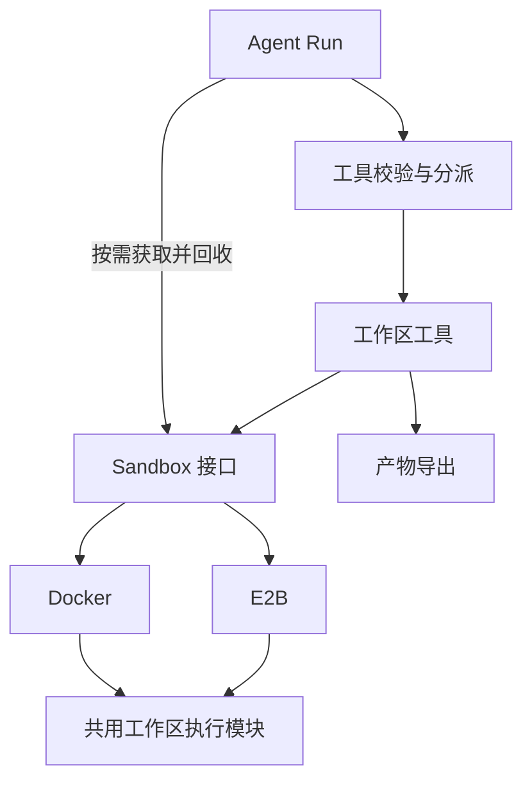

# 工作区工具与沙箱

模型调用的是一套工作区工具。`ToolRegistry` 检查工具授权和参数，处理函数取得当前 Run 的 `Sandbox`。Docker 和 E2B 负责创建环境、传输请求和回收资源，环境内使用同一份 Python worker。文件、命令和浏览器因此可以共享同一个工作区。



## 工具清单

| 工具 | 接口与行为 |
|---|---|
| `ls` | 列出文件和子目录。默认查看工作区根目录一层，可递归、按类型过滤和分页。 |
| `read_file` | 按行读取工作区里的 UTF-8 文本，`next_line` 可用于继续阅读。 |
| `search_files` | 按 glob 找文件，可选字面文本查询并返回行号。文本搜索会跳过常见依赖目录和二进制文件。 |
| `write_file` | 原子写入整份 UTF-8 文本，按需创建父目录。`overwrite` 可以控制覆盖。 |
| `copy_file` | 复制工作区里的单个文件，支持二进制，默认保留已有目标。 |
| `run_command` | 用 `argv`、`cwd` 和 `timeout_seconds` 运行 Python、Node.js 或其他镜像内程序。返回退出码、stdout、stderr、超时与截断状态。 |
| `playwright` | 预览工作区 HTML 或沙箱内的环回 URL，也可访问任务配置的公网 HTTPS 页面。可执行点击、填值、按键、文本断言并保存 PNG。预览本地服务时可用 `server_argv` 启动临时服务。 |
| `generate_image` | 用配置的 OpenRouter 图片模型生成一张图，返回工作区路径、格式、字节数和模型 ID。 |
| `submit_results` | 批量导出指定文件，返回 `ArtifactRef` 并记录产物和 UI 附件。随后 Agent 可以继续总结结果。 |

`run_command` 统一了命令执行入口。需要 shell 时，可以在 `argv` 中显式选择 `bash`。工作目录和执行超时由 worker 校验，命令超时会结束该进程组并返回已捕获的输出。[OpenAI Shell 工具指南](https://developers.openai.com/api/docs/guides/tools-shell)

常规文件操作使用工作区相对路径。`playwright` 适合验证 Agent 生成的本地网页和启动的测试服务器，截图写回工作区。用 `submit_results` 选出交付文件，批次在全部读取成功后才出现在产物目录中。

`ls` 的 `directory` 默认为 `.`。用 `kind=file` 或 `kind=directory` 筛选类型，用 `recursive=true` 查看子目录。结果按路径排序。下一页沿用原参数，将 `next_cursor` 传入 `cursor`。如果 `truncated=true` 且 `next_cursor` 为空，可以缩小目录范围继续查找。

## 网页检索和浏览器补查

在任务 JSON 中设置 `web.enabled`，模型可以用同一个 `OPENROUTER_API_KEY` 搜索网页和抓取指定 URL。OpenRouter 在模型请求内执行 `openrouter:web_search` 和 `openrouter:web_fetch`，模型按需选择。运行记录的 `model.finished` 会记录服务端返回的网页工具用量和来源。[OpenRouter 托管工具](https://openrouter.ai/docs/guides/features/server-tools)

```json
{
  "task": "Find the OpenRouter web fetch guide, verify its supported engines, and submit a short note with the source URL.",
  "web": {
    "enabled": true,
    "browser_origins": ["https://openrouter.ai"]
  }
}
```

`web.browser_origins` 可以独立配置，填写允许访问的 HTTPS 来源。Playwright 继续用 `url`、`actions` 和可选的 `screenshot` 查询公网网页。首次公网调用会启动独立的 Docker 或 E2B 浏览器沙箱。代理核对连接来源和目标 IP，浏览器拦截常规页面请求，只放行 GET 和 HEAD。截图写回任务工作区，之后可以通过 `submit_results` 提交。浏览器访问的页面记录在 `browser.page_read`。

只使用搜索和抓取时，直接用 `--request` 运行即可。配置了公网浏览器来源时，选择 `--sandbox docker` 或 `--sandbox e2b`，并构建含新版 worker 的镜像。任务 Shell 的出网通过 `--sandbox-network` 单独配置。页面依赖的 CDN 等跨域资源也需要列出对应的 HTTPS 来源。

## 按需读取 Skill

使用 Docker 或 E2B 沙箱时，可以用 `--skills-dir` 配置本机的 Skill 目录，可重复指定。目录包含一组 Skill 子目录，每项以带 YAML frontmatter 的 `SKILL.md` 为入口，`name` 与目录名一致。

用 `--skill` 指定本次任务需要的 Skill。使用 JSON 任务请求时，通过 `skills` 数组指定名单。[Plugin 和任务扩展](plugins.md)

```bash
uv run --project agent agent-cook --sandbox docker --skills-dir /path/to/skills \
  '找到适合这个任务的 Skill，并说明它的步骤。'
```

初始模型上下文只包含每项 Skill 的 `name`、`description` 和 `entry`。工作区首次打开时，将已配置 Skill 的包文件按原目录结构复制到工作区。比如 `example/SKILL.md` 对应沙箱内的 `/workspace/example/SKILL.md`。

模型可以用 `read_file` 读取 `example/SKILL.md`，用 `ls` 查看 `example/references`，也可以在 `run_command` 里用解释器运行 `example/scripts` 里的脚本。Skill 包仅传输普通文件，与用户输入共用传输上限。同名的工作区输入会报错，运行期间的修改保存在当前任务的副本里。

## 生图

使用沙箱时，设置 `OPENROUTER_IMAGE_MODEL` 或传 `--image-model` 即可启用 `generate_image`。选择支持 OpenRouter Image API 的模型。对话和生图复用 `OPENROUTER_API_KEY`，由主进程分别调用对应接口。[OpenRouter Image API](https://openrouter.ai/blog/tutorials/image-generation/)

| 工具参数 | 用法 |
|---|---|
| `prompt` | 必填。描述画面、风格和构图。 |
| `aspect_ratio` | 可选。指定宽高比，例如 `16:9`、`9:16` 或 `1:1`。 |
| `resolution` | 可选。指定模型支持的分辨率档位，例如 `1K` 或 `2K`。 |
| `output_dir` | 可选。工作区相对目录，默认为 `generated-images`。文件名由工具生成。 |

比例和分辨率沿用所选模型的默认值，除非调用时显式指定。工具用实际图片格式确定扩展名，支持 PNG、JPEG 和 WebP，单张图片最多 16 MiB。可以用返回的 `path` 将图片放进网页，也可以用 `submit_results` 导出。

```bash
export OPENROUTER_IMAGE_MODEL='bytedance-seed/seedream-4.5'
uv run --project agent agent-cook --sandbox docker --timeout 240 \
  '生成一张 16:9 的深蓝色城市夜景，用 submit_results 交付图片。'
```

## 本地 Docker

在仓库根目录构建镜像。镜像包含 Python、Node.js 和 Playwright Chromium。

```bash
docker build -f sandbox/Dockerfile -t agent-cook-sandbox:local .

export OPENROUTER_API_KEY='your-key'
export OPENROUTER_MODEL='provider/model'
uv run --project agent agent-cook --sandbox docker --max-turns 16 --timeout 180 \
  '在工作区写一个计数器网页，用 playwright 点击按钮并截屏。用 submit_results 交付网页和截图。'
```

`--input` 可以重复使用，每个指定的本地文件以原文件名复制到这次工作区。Docker 每个 Run 启动一个容器，在里面使用独立的工作区。`--sandbox-network` 可以按需开启出网安装依赖。

## 远程 E2B

用同一个 Dockerfile 构建 OCI 镜像，把镜像放到 E2B 可读取的镜像仓库，然后以它为基础创建模板。模板需要保留工作区执行模块、`/workspace` 和镜像里的 `cook` 用户。

```bash
export E2B_API_KEY='your-key'
export AGENT_COOK_IMAGE='registry.example/agent-cook-sandbox:0.1'
uv run --project agent --extra e2b python - <<'PY'
import os
from e2b import Template

Template.build(Template().from_image(os.environ["AGENT_COOK_IMAGE"]), alias="agent-cook")
PY

export E2B_TEMPLATE='agent-cook'
uv run --project agent --extra e2b agent-cook --sandbox e2b \
  '写一份简短的结果文件并用 submit_results 交付。'
```

远程后端同样在首次工具调用时创建，Run 退出时关闭。E2B 公网入口采用访问令牌保护，两种后端默认关闭任务出网。模型和 E2B 的 API Key 由宿主进程使用。[E2B 模板构建说明](https://e2b.dev/resources/introducing-build-system-2-0)

## 输出与上限

CLI 在标准错误打印 trace 和产物路径。`artifact.created` 事件的路径相对于 trace 所在目录，回放可以直接读取对应文件。截图、网页、Excel 和 PPTX 可以一起提交。

- 单个输入或产物文件上限 16 MiB。单次输入或产物批次上限 32 MiB。
- `read_file` 面向不超过 1 MiB 的文本文件，按行范围与返回长度分页。大型文件可以在沙箱内用 `run_command` 处理。
- `run_command` 默认 30 秒，单条最多 120 秒，stdout 和 stderr 各保留至 16 KiB。CLI 的 `--timeout` 管整个 Run。
